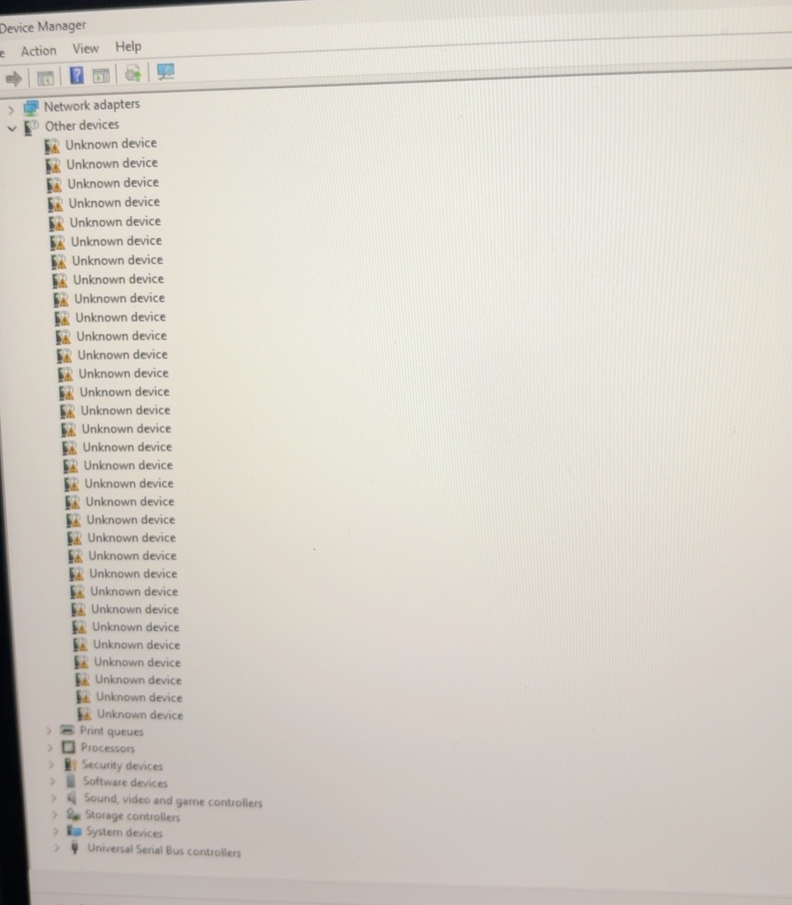
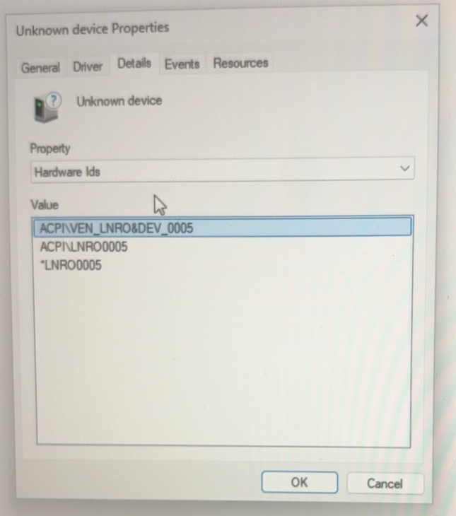
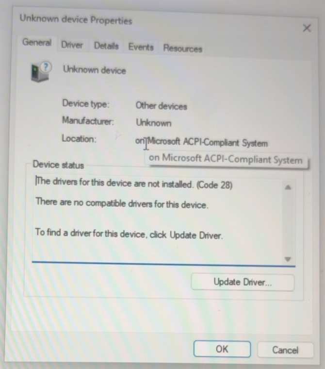
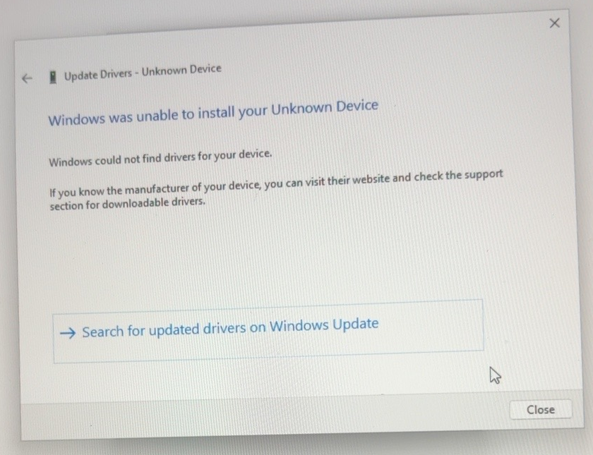

# windows-11-driver-troubleshooting-lab
Hands-on IT Support lab documenting Windows 11 ARM64 driver troubleshooting using Device Manager and UTM.

# Windows 11 Driver Troubleshooting Lab

## Project Overview
This hands-on IT Support lab documents the investigation of missing device drivers in a Windows 11 ARM64 virtual machine running in UTM on macOS.

The goal was to practise identifying unknown devices, interpreting Windows Device Manager error codes, and searching for compatible drivers using a structured troubleshooting process.

## Lab Environment
- Host: Apple Silicon MacBook Air
- Virtualization software: UTM (QEMU)
- Guest operating system: Windows 11 ARM64
- Tools: Device Manager, Windows Update, File Explorer, UTM Guest Tools

## Problem Description
Device Manager displayed multiple unknown devices with yellow warning icons. One investigated device reported Error Code 28, indicating that its driver was not installed.

Hardware ID investigated:

`ACPI\VEN_LNR0&DEV_0005`

## Troubleshooting Steps
1. Opened Device Manager and expanded Other devices.
2. Inspected an unknown device under Properties > General.
3. Identified Error Code 28: drivers not installed.
4. Opened Properties > Details > Hardware Ids to collect the device identifier.
5. Checked Windows Update > Advanced options > Optional updates. No optional updates were available.
6. Opened the mounted UTM Guest Tools CD drive.
7. Examined the driver directories, including `E:\Drivers\NetKVM\w11\ARM64`.
8. Used Update Driver > Browse my computer for drivers and searched `E:\Drivers` with subfolders included.
9. Windows reported that it could not find a compatible driver for the selected unknown device.

## Results
- Successfully identified a device reporting Error Code 28.
- Collected its Hardware ID.
- Verified that the guest tools package contains Windows 11 ARM64 driver files for some virtual devices.
- No compatible driver was found for the investigated unknown device.
- The issue remains unresolved; no unrelated driver was force-installed.

## Skills Demonstrated
- Windows Device Manager troubleshooting
- Hardware ID investigation
- Driver compatibility checks
- Windows Update troubleshooting
- Windows 11 ARM64 virtual machine administration
- Technical documentation and escalation readiness

## Evidence

### 1. Unknown Devices in Device Manager

### 2. Hardware ID Investigation

### 3. Error Code 28

### 4. Driver Search Result

  

## Lessons Learned
Error Code 28 indicates a missing driver, but not necessarily damaged hardware. Drivers must match both the device and the operating system architecture. When a compatible driver cannot be found, the technician should document the investigation and continue compatibility research or escalate the issue.

## Future Work
- Investigate the ACPI hardware identifier and relevant QEMU device support.
- Review remaining unknown devices individually.
- Verify driver support before making additional changes.

## Author
IT Support Learning Portfolio | Windows Troubleshooting Lab
  
